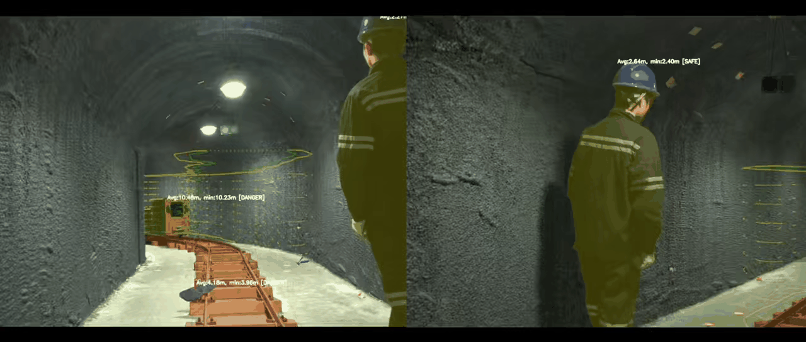
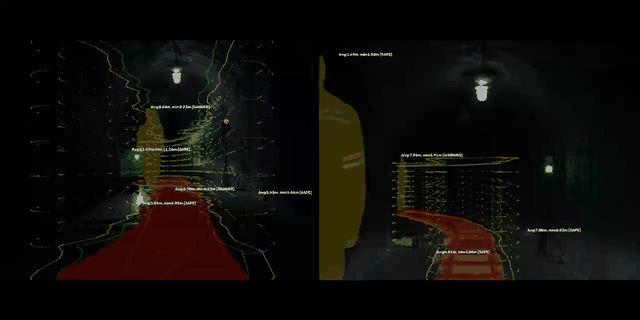
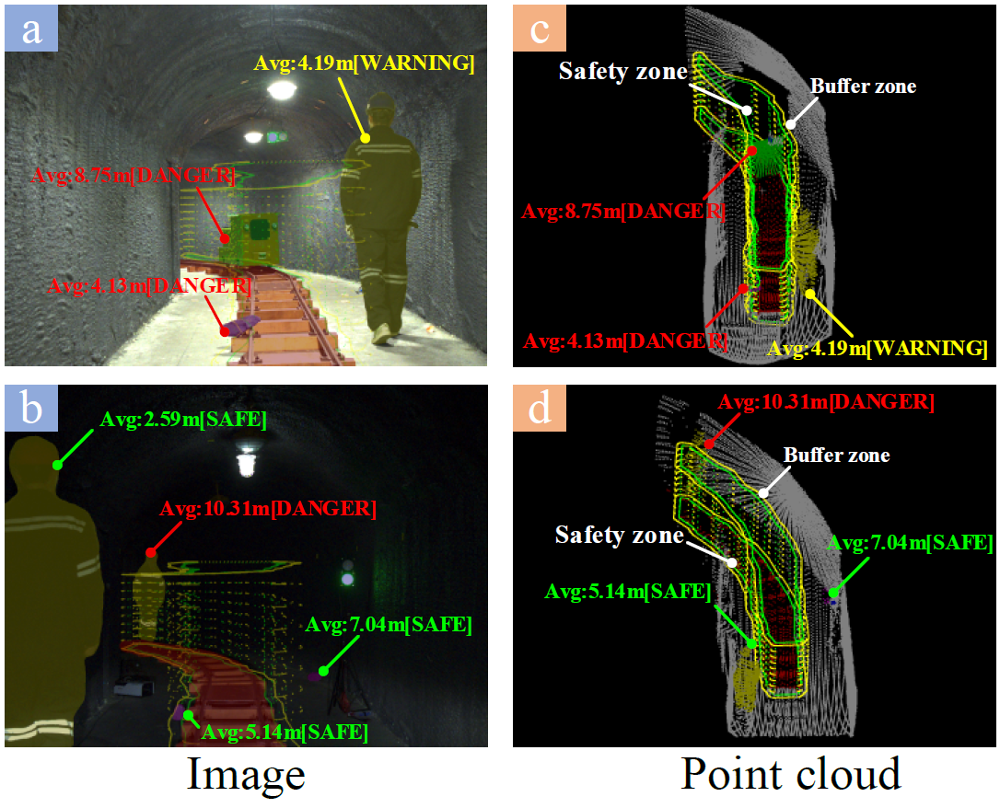

 ---

# Obstacle Perception Method for Autonomous Electric Locomotives Based on Visual Semantic Guidance and LiDAR Point Cloud Spatial Constraints


### ✨ Visualization Results

Visualized GIF under normal illumination



Visualized GIF under low illumination




## 📊 Experimental Results and Analysis

### 1. Semantic Segmentation Model (MSFA-Unet) Comparison

To validate the effectiveness of the proposed MSFA-Unet, we compare it with other state-of-the-art semantic segmentation models:

| Model Name     | MIoU(%) | PA(%)  | mRecall(%) | FPS    |
|----------------|---------|--------|------------|--------|
| DDRNet     | 69.97   | 95.53  | 76.82      | 110.89 |
| STDC1      | 70.21   | 95.80  | 76.02      | 181.54 |
| BiSeNetV1  | 71.04   | 98.45  | 73.05      | 210.55 |
| PIDNet    | 73.54   | 96.37  | 78.77      | **217.77** |
| PSPNet    | 88.50   | 98.41  | 96.39      | 182.52 |
| YOLOv12    | 88.53   | 98.56  | 94.53      | 101.86 |
| YOLOv11    | 89.12   | 98.58  | 94.76      | 149.28 |
| Swin-UNet  | 89.13   | 97.97  | 94.51      | 156.07 |
| U-Net     | 90.46   | 98.96  | 95.35      | 74.44  |
| SegFormer  | 90.73   | 98.75  | 95.13      | 95.76  |
| YOLOv26   | 91.02   | 98.76  | 95.19      | 197.81 |
| DeepLabV3+ | 91.46   | 98.82  | 95.89      | 138.83 |
| OneFormer  | 92.20   | **99.01**  | 95.46      | 27.50  |
| Ours           | **93.31**   | 98.93  | **96.62**      | 116.92 |


---

### 2. Point Cloud Growth and Offset Correction Analysis

Quantitative evaluation of the proposed method:

| Method                  | P(%)      | R(%)      | F1        |
|-------------------------|-----------|-----------|-----------|
| Direct Perspective Projection | 91.92 | 87.93 | 0.8940 |
| Euclidean clustering | 96.65     | 84.77     | 0.8989    |
| OPTICS             | 83.12     | 68.24     | 0.7228    |
| HDBSCAN             | 96.68     | 84.51     | 0.8961    |
| Painted-Graph       | 95.84     | 85.06     | 0.8972    |
| MeanShift           | **97.50** | 69.28     | 0.8043    |
| Ours                    | 95.95     | **95.49** | **0.9534** |


---

### 3. Visualization of traversable space.



---

## Code for Paper Verification: Semantic Segmentation Inference, Evaluation, and Point Cloud Region Growing

### Description

This repository currently provides inference and evaluation code for the core algorithms in the paper. Full code, preprocessing pipelines, and datasets will be released after the paper is officially accepted.

---

### Environment Setup

Install dependencies in an Anaconda environment:

```powershell
cd your_project
conda activate your_env
pip install -r requirements.txt
```

For GPU support, install the appropriate `torch` version according to your CUDA version from the [PyTorch official website](https://pytorch.org), then install other dependencies.

---

## Usage Instructions

### 1. Generate Semantic Segmentation Outputs

Script: `gen_seg_outputs.py`

Outputs three types of results:

| Subdirectory | Description                 |
| ------------ | --------------------------- |
| blended/     | Original image with overlay |
| color/       | Colored masks               |
| origin/      | Grayscale label maps        |

**VOC-style input:**

```powershell
python gen_seg_outputs.py --read-mode test_txt --test-txt path/to/test.txt --jpeg-dir path/to/JPEGImages --out-dir out --model path/to/weights.pth
```

Example:

```powershell
python gen_seg_outputs.py --read-mode test_txt --test-txt ./dataset/VOC2007/test.txt --jpeg-dir ./dataset/VOC2007/JPEGImages --out-dir out --model ./weights/best.pth
```

---

### 2. Semantic Segmentation Evaluation

Script: `eval_msfa_unet.py`

Computes mIoU, Precision, Recall, F1, Accuracy, and FPS.

Dataset structure:

```
dataset/
  VOC2007/
    test.txt
    JPEGImages/
    SegmentationClass/
```

Configure in `EvalConfig`:

* `VOCdevkit_path`
* `model_path`
* `num_classes`, `name_classes`, `input_shape`

Run:

```powershell
conda activate your_env
python eval_msfa_unet.py
```

---

### 3. Point Cloud Region Growing Evaluation

Script: `eval_region_grow.py`

Compares baseline and region-growing results.

**Inputs:**

* Baseline: `base.xlsx`
* Region growing: `base_region_grow.xlsx`
* Ground truth: `base.pcd`

Run:

```powershell
python eval_region_grow.py --origin-dir path/to/xlsx_dir --label-dir path/to/pcd_dir --region-grow-dir path/to/rg_xlsx_dir
```

Example:

```powershell
python eval_region_grow.py --origin-dir ./dataset/pcd_offset_compensation/seg_zy --label-dir ./dataset/pcd_offset_compensation/seg_zy_label
```

Results are saved to:

```
out/eval_region_grow_results.xlsx
```

---

### Dataset and Model Weights

[Download dataset and weights](https://pan.baidu.com/s/1CVguEKNr28mQ_zb6uRjUsA?pwd=dfmf)

---